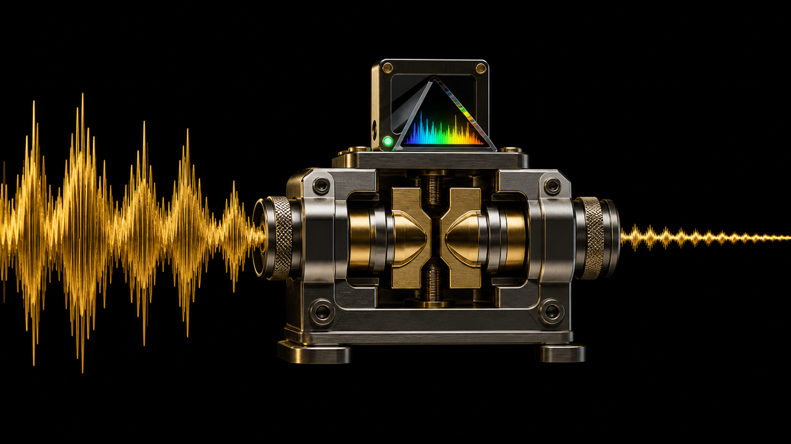
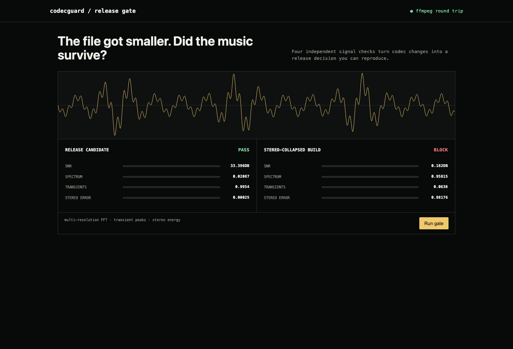

# codecguard

**A CI quality gate for audio codec changes.**

Generate a reference master, execute a real FFmpeg encode/decode, and fail a release when the codec damages spectrum, transients, stereo width, or signal-to-noise ratio.





## What ships

- Deterministic stereo master with tones, chirps, wide content, and hard transients
- Real AAC/MP3/Opus round trips through FFmpeg
- Multi-resolution spectral convergence, SNR, transient-retention, and stereo-width gates
- CLI, JSON API, interactive regression console, Docker, tests, and CI

## Run it end to end

```bash
python -m venv .venv && source .venv/bin/activate
python -m pip install -e .
codecguard benchmark artifacts --codec aac --bitrate 192k
codecguard serve
```

## Demo result

The release candidate preserves the test master and passes all four gates. A low-pass, stereo-collapsed regression is rejected with the failed dimensions shown independently. The integration test also encodes and decodes a real AAC artifact before measuring it.

## Research basis

Codec evaluation needs complementary time, frequency, spatial, and perceptual evidence. This focused implementation makes the deterministic signal-level layer reproducible in CI; listening tests remain part of release sign-off.

## Test

```bash
python -m unittest discover -s tests -v
```

MIT licensed.
